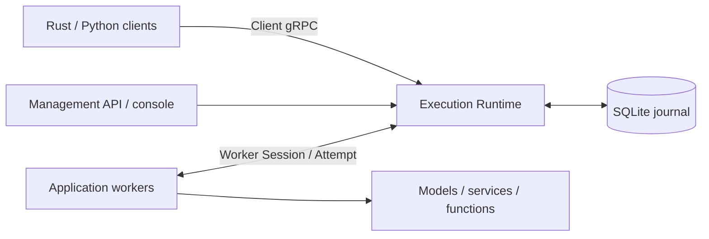
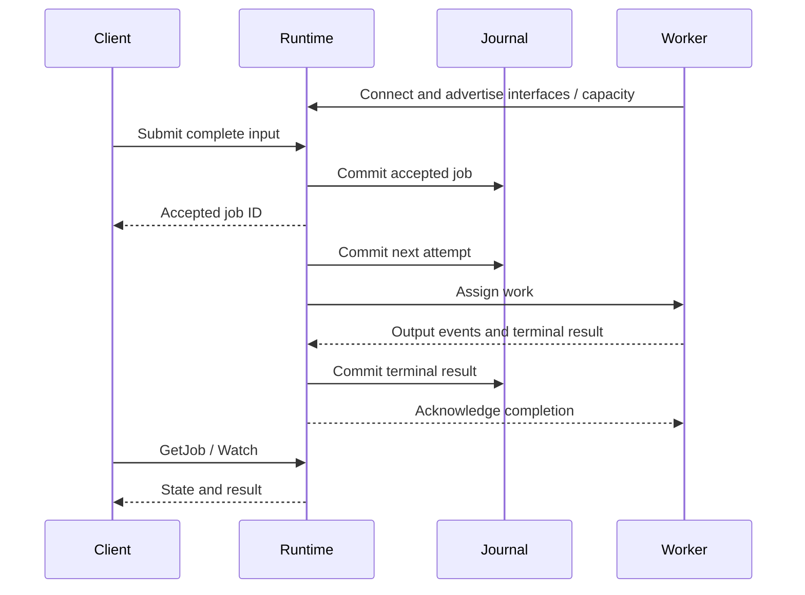

# Architecture

Anyserve is a backend-independent execution and scheduling system. One
control-plane process owns a Runtime and, optionally, a SQLite recovery journal.
Clients send opaque objects; application workers connect outbound and own their
backends.

The Runtime owns admission, placement, attempts, deadlines, cancellation and
bounded delivery. Workers own data interpretation, model loading and batching.
The deployment platform owns GPU allocation, replicas, networking and storage.

## Execution

| Property | Invoke | Submit |
|---|---|---|
| Lifetime | Disconnecting cancels unfinished work | Independent of the watching client |
| Input | Complete objects or live chunks | Complete input before acceptance |
| Output | Live events and terminal result | GetJob and Watch |
| Durability | Ephemeral | Durable by default; explicit ephemeral is supported |
| Restart | Lost | Committed input, attempt count and terminal result survive with a journal |

The journal exchanges apply to durable Submit. Public states are `queued`,
`running`, `succeeded`, `failed` and `cancelled`. A retry returns an eligible job
to the queue. Durable acknowledgement means the corresponding commit completed.

## Placement

An interface names a worker capability, such as `policy.evaluate.v1`. Workers
advertise interfaces, string attributes, resource quantities and concurrency.
Jobs require an interface and may add constraints:

1. Required attributes and capacity must match a connected worker with a free
   slot. Capacity is advertised accounting; Kubernetes or the backend enforces
   physical resources.
2. Preferred attributes rank candidates. With `spillover_after_ms`, all
   preferences must match during that queued interval; afterward partial
   matches are allowed while required constraints still apply.
3. Eligible jobs use higher priority first, then arrival order within an
   interface. Worker selection prefers matching attributes and lower load;
   workers that rejected this job are less preferred.

## Retries and deadlines

`max_attempts` includes the first attempt. Zero selects the server default
(3); one disables execution retries; values are capped at 20. A retryable worker
failure or a lost worker can start another attempt within this budget.
Worker SDK transport retries resend the same result without running the handler
again. External side effects require application idempotency because an
unfinished durable job may execute again after a restart.

Once a non-progress output event enters the stream, that attempt is *exposed*.
It cannot silently switch workers; an interrupted exposed attempt ends with
`output_interrupted`. Clients should use context managers when leaving Invoke
streams early so cancellation reaches the worker.

| Deadline | Scope |
|---|---|
| Queue timeout | Each period waiting for an attempt to start |
| Execution timeout | One attempt; expiry can retry |
| Total timeout | Acceptance to terminal state across all attempts |
| Heartbeat timeout | Worker silence, then a reconnect grace period of the same length |
| Consumer stall timeout | Bounded waiting for streamed delivery |

## Persistence and bounded delivery

The journal has one writer and an exclusive process lock. A replacement server
recovers durable jobs after the previous process exits. Live frames, event
history and worker-local model/session state are not recovered. Deadlines use
wall-clock time across a restart, so downtime consumes the remaining budget.
See [deployment](deployment.md) for replacement and backup procedures.

Input, result and event budgets bound retained payloads. Slow Invoke consumers
back-pressure workers and can fail with `consumer_stalled`. Other event readers
can receive cursor expiry when history is evicted. GetJob can still return a
retained durable result after its in-memory events expire. Limits and retention
are listed in [configuration](configuration.md).

## Terms

| Term | Meaning |
|---|---|
| Execution domain | One control plane and its journal, with their own jobs and workers |
| Attempt / lease | One execution of a job / the worker's authority to complete it |
| Credit | Worker-reported free slots for new assignments |
| Drain | Stop taking new assignments while finishing existing ones |
| Fence | Revoke an old lease so its later messages cannot change the job |
| Generation | Server lifetime identifier used to reject work from an earlier lifetime |
