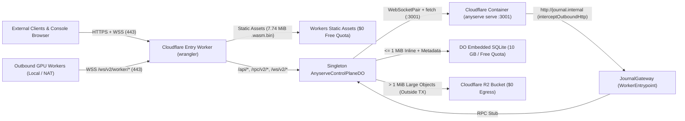

# AnyServe Cloudflare 全栈部署实施计划（选项 1 + Tier 3 一步到位）

## 目标与背景 (Goal Description)

本计划用于在 **Cloudflare Containers + Workers Static Assets + Durable Object SQLite + R2** 上实现 **AnyServe** 的全托管、零外部服务器、零第三方数据库原生部署（对应 **选项 1 `Tier 0 + Tier 2 -> 架构 2A` + `Tier 3`**）：

- **单域名单端口统一承载**：通过一个 Cloudflare 域名（`https://` 与 `wss://`），由入口 Cloudflare Worker 同时托管 React Console 静态界面、管理 API（`/api/*`）、以及支持全双工双向流式的业务执行通道（`/rpc/v2/*` 与 `/ws/v2/*`），**无需 Cloudflare Pro / Spectrum TCP、无需手工申请或轮换 TLS 证书**。
- **控制面无外部依赖持久化**：在 Cloudflare Containers 中运行 `anyserve serve`（可关闭内部未暴露的 gRPC 端口，仅监听 `:3001` Axum 服务），并通过 `interceptOutboundHttp("journal.internal", ...)` 对接宿主单例 Durable Object 内置的 **10 GB SQLite (`ctx.storage.sql`) + Cloudflare R2**，支持 `durable` 作业的崩溃恢复、租约防脑裂（Fencing）与大对象分流存储，**无需采购或维护外部 PostgreSQL / VPS**。
- **向后完全兼容**：保留原有原生 HTTP/2 gRPC（`http://` / `https://`）、本地磁盘 SQLite Journal 与 PostgreSQL Journal；客户端与 Worker 根据 Endpoint Scheme（`ws://` / `wss://` vs `http://` / `https://`）自动选择传输协议。



---

## 需要确认的设计决策 (User Review Required)

> [!IMPORTANT]
> **Tier 0 DuckDB-WASM 体积超限处理：默认采用单包预压缩 `.wasm.bin` + 浏览器原生 `DecompressionStream`**
>
> 目前 `console/dist` 构建出的 `duckdb-eh-*.wasm` 为 **34.25 MiB**，超出 Cloudflare Workers Static Assets 单文件 **25 MiB** 硬限制，且 `duckdb-browser-eh.worker.js` 中的 `new Worker(...)` 受浏览器同源策略约束无法直接迁至独立 CDN 域名。
> - **默认方案**：构建期使用 Node `zlib.gzipSync` 将其压缩为约 **7.74 MiB** 的 `duckdb-eh-<hash>.wasm.bin` 并删除原始 `.wasm`，浏览器的 `AnalyticsEngine.create()` 通过 `DecompressionStream("gzip")` 解压并以 `Blob(..., { type: "application/wasm" })`（`type` 不可省略，因 `WebAssembly.instantiateStreaming` 严格校验 MIME）加载，实现 **`wrangler deploy` 单命令零额外步骤部署**。
> - **可选扩展**：同步支持 `VITE_DUCKDB_WASM_URL` 环境变量覆盖，后续如需零浏览器解压开销，可按需切到同域 Worker + R2。

> [!NOTE]
> **Tier 2 单端口复用与 `grpc_enabled` 配置开关**
>
> 为支持 Cloudflare Container 内仅开放 `:3001` 一条 HTTP/WebSocket 通道，计划在 `[server]` 配置段增加可选 `grpc_enabled: Option<bool>`（默认 `true` 以保持兼容；`deploy/cloudflare/server.toml` 中设为 `false`）。
> 当客户端 / Python Worker 使用 `wss://...` 或 `ws://...` 时，SDK 自动映射至 `POST /rpc/v2/client/*`（Protobuf over HTTPS）与 `/ws/v2/*`（二进制 Protobuf over WebSocket + 30s RFC 6455 `Ping`）；原有 `http://` / `https://` 地址继续走 `tonic` HTTP/2 gRPC。

> [!WARNING]
> **Tier 3 DO SQLite 容量、参数与事务约束（`1 MiB` R2 溢出阈值）**
>
> Cloudflare Durable Object SQLite 单行 / BLOB 上限为 **8 MB**、单条 SQL 语句最长 **100 KB**、每条查询最多 **100 个绑定参数**，且 `ctx.storage.transactionSync()` 内 **禁止 `await` 异步调用（如 R2 `put`）**。
> - 因此计划将 `<= 1 MiB` 的对象直接存入 DO SQLite，将 **`> 1 MiB` 的大对象在进入 `transactionSync()` 前异步写入 R2（按写幂等 `jobs/{job_id}/{role}/{idx}` 键命名）**，并将批量提交拆分为分片循环逐条入库（避免超出 100 绑定参数上限）；预览读取通过 SQLite `SUBSTR(content, 1, 4096)` 或 R2 Range `{ offset: 0, length: 4096 }` 完成。

---

## 详细改造方案 (Proposed Changes)

按底层依赖顺序分为 **6 个独立模块**：

### 模块 1：配置、角色鉴权与 Cloudflare 运行时模式

#### [MODIFY] [auth.rs](../crates/anyserve-core/src/auth.rs)
* 现有 [`verify`](../crates/anyserve-core/src/auth.rs#L208-L231) 硬编码了 `/anyserve.v2.Worker/` 与 `/anyserve.v2.Client/` 路径前缀，直接复用在 `/rpc/v2/*` 或 `/ws/v2/*` 会造成开启鉴权时 **Worker Token 越权调用 Client 接口**、关闭鉴权时 Worker 报错 `PermissionDenied`。
* 在已有的 [`verify_client_headers`](../crates/anyserve-core/src/auth.rs#L233-L244) 旁补齐对称的 **`verify_worker_headers(&self, headers: &HeaderMap) -> Result<Principal, Status>`**：
  ```rust
  pub fn verify_worker_headers(&self, headers: &HeaderMap) -> Result<Principal, Status> {
      if !self.is_enabled() {
          return Self::unauthenticated_principal(Role::Worker, headers);
      }
      match bearer_token(headers).and_then(|token| self.principal_for_token(token)) {
          Some(principal) if principal.role == Role::Worker => Ok(principal),
          Some(_) => Err(Status::permission_denied(
              "client token cannot be used for worker requests",
          )),
          None => Err(Status::unauthenticated("missing or invalid bearer token")),
      }
  }
  ```

#### [MODIFY] [api.rs](../crates/anyserve-core/src/runtime/api.rs)
* 新增 `CloudflareJournalConfig` 并在 [`JournalConfig`](../crates/anyserve-core/src/runtime/api.rs#L705-L739) 上增加 `pub cloudflare: Option<CloudflareJournalConfig>` 与构造器 `JournalConfig::cloudflare(endpoint)`：
  - 字段：`endpoint: String`、`auth_token: Option<String>`（自定义 `Debug` 实现脱敏 `REDACTED`）、`lease_duration: Duration`（默认 `15s`）、`poll_interval: Duration`（默认 `200ms`）、`r2_spill_threshold_bytes: usize`（默认 `1 MiB`）。

#### [MODIFY] [file.rs](../crates/anyserve-cli/src/serve_config/file.rs)、[serve_config.rs](../crates/anyserve-cli/src/serve_config.rs)、[serve_runtime.rs](../crates/anyserve-cli/src/serve_runtime.rs)、[api.rs](../crates/anyserve-cli/src/serve_console/api.rs) 与 [handlers.rs](../crates/anyserve-cli/src/serve_console/handlers.rs)
* `[server]`（[`ServerConfigFile`](../crates/anyserve-cli/src/serve_config/file.rs#L110-L114) / [`GrpcConfig`](../crates/anyserve-cli/src/serve_config.rs#L16-L22)）：增加 `grpc_enabled: Option<bool>`（默认 `true`）。当 `grpc_enabled = false` 时跳过 `run_grpc_server`（要求 `[console]` 保持启用）。
* `[console]`（[`ServeConsoleConfigFile`](../crates/anyserve-cli/src/serve_config/file.rs#L118-L138)）：增加 `public_endpoint: Option<String>`，透传至 `ControlPlaneStatic` 与 `ControlPlaneSummary`（`/api/overview`）。
* `[runtime]`（[`RuntimeConfigFile`](../crates/anyserve-cli/src/serve_config/file.rs#L293-L313)）：补齐 `max_inline_object_bytes: Option<u64>` 与 `max_inline_total_bytes: Option<u64>` 配置映射，配合 `deploy/cloudflare/server.toml` 控制单包内存占用。
* `[journal]`（[`JournalConfigFile`](../crates/anyserve-cli/src/serve_config/file.rs#L150-L170)）：在 `JournalBackend` 枚举中增加 `Cloudflare`（支持 `backend = "cloudflare"`、`endpoint` / `url_env` 默认读取 `"ANYSERVE_CLOUDFLARE_JOURNAL_URL"` 或默认值 `http://journal.internal`、`token_env`），并在 [`RuntimeMode`](../crates/anyserve-cli/src/serve_config.rs#L58-L78) 新增 `MemoryPlusCloudflare`（`code = "memory_plus_cloudflare"`、`label = "Memory + Cloudflare journal"`、`journal = "cloudflare"`）。

---

### 模块 2：Tier 0 — Console 前端 WASM 压缩与公网接入弹窗

#### [MODIFY] [vite.config.ts](../console/vite.config.ts)
* 新增仅在 `vite build` 时生效的 `writeBundle` 插件：读取 `dist/assets/duckdb-eh-*.wasm`，使用 `node:zlib` 的 `gzipSync` 生成 `duckdb-eh-*.wasm.bin`（约 `7.74 MiB`）并删除原始 `.wasm` 文件（可通过 `ANYSERVE_BUNDLE_GZIP_WASM=0` 关闭），确保 `console/dist` 下所有文件均小于 Workers Static Assets 的 `25 MiB` 单文件上限。

#### [MODIFY] [analytics-engine.ts](../console/src/analytics-engine.ts)
* `duckdb-browser-eh.worker.js`（755 KiB）继续保留同源静态资产，消除跨域 `SecurityError`。
* 修改 [`AnalyticsEngine.create()`](../console/src/analytics-engine.ts#L20-L29)：支持 `import.meta.env.VITE_DUCKDB_WASM_URL`；若资源以 `.wasm.bin` 结尾，先通过 `fetch()` 获取响应体并使用原生 `DecompressionStream("gzip")` 解压，生成 `new Blob([buf], { type: "application/wasm" })` 后以 `URL.createObjectURL(blob)` 传入 `db.instantiate(url)`，在 `try/finally` 中及时释放 `revokeObjectURL`。

#### [MODIFY] [types.ts](../console/src/types.ts) 与 [ConnectWorkerModal.tsx](../console/src/ConnectWorkerModal.tsx)
* `types.ts`：`RuntimeModeSummary` 兼容 `"memory_plus_cloudflare"` / `"cloudflare"`，`ControlPlaneSummary` 新增可选 `public_endpoint?: string | null`。
* `ConnectWorkerModal.tsx`：`deriveEndpoint()` 优先使用 `controlPlane?.public_endpoint || import.meta.env.VITE_PUBLIC_ENDPOINT`（缺省再回退原 `grpc_listen` 逻辑）；当地址为 `wss://` 或 `ws://` 时调整弹窗副标题为 `"Workers open outbound WebSocket streams to ..."`，并复用已有 `CopyableBlock` 展示准确的一键接入代码。

---

### 模块 3：Tier 2 — Axum 单端口 HTTP + WebSocket Protobuf 服务端

#### [MODIFY] [Cargo.toml](../Cargo.toml) 与 [crates/anyserve-core/Cargo.toml](../crates/anyserve-core/Cargo.toml)
* Workspace 启用 `axum = { version = "0.7.9", features = ["ws"] }`、`reqwest = { version = "0.12.15", default-features = false, features = ["json", "rustls-tls-webpki-roots"] }`，新增 `tokio-tungstenite = { version = "0.24", features = ["rustls-tls-webpki-roots"] }`（供客户端安全校验 Cloudflare `wss://` 证书）及 `base64 = "0.22"`。
* `crates/anyserve-core/Cargo.toml` 引入 `axum`、`reqwest`、`base64`。

#### [NEW] `crates/anyserve-core/src/http_ws_service.rs` 与 [MODIFY] [lib.rs](../crates/anyserve-core/src/lib.rs)、[handlers.rs](../crates/anyserve-cli/src/serve_console/handlers.rs)
* **导出服务构建函数**：复用 [`client_service.rs`](../crates/anyserve-core/src/client_service.rs) 与 [`worker_service.rs`](../crates/anyserve-core/src/worker_service.rs) 内部的校验、Proto 转换、输入泵送与事件流订阅逻辑，提供 `http_ws_service::router(runtime: Runtime, auth: Arc<AuthPolicy>) -> Router<()>`。
* **路由与帧协议**：
  * **4 个 Unary RPC**（仅限 `verify_client_headers`）：
    - `POST /rpc/v2/client/submit` (`SubmitRequest` -> `SubmitResponse`)
    - `POST /rpc/v2/client/get_job` (`GetJobRequest` -> `Job`)
    - `POST /rpc/v2/client/cancel` (`CancelRequest` -> `Job`)
    - `POST /rpc/v2/client/list_jobs` (`ListJobsRequest` -> `ListJobsResponse`)
    - 请求/响应 `Content-Type: application/x-protobuf`；显式挂载 `DefaultBodyLimit::max(anyserve_proto::MAX_MESSAGE_SIZE)`（64 MiB，低于 Cloudflare 100 MiB 上限，避免 Axum 默认 2 MiB `413` 拦截）；失败时通过 HTTP 状态码 + `x-anyserve-grpc-code` Header + UTF-8 body 精确还原 `tonic::Code`。
  * **4 个流式 WebSocket RPC**（配置 `.max_frame_size(32 * 1024 * 1024).max_message_size(anyserve_proto::MAX_MESSAGE_SIZE)` + **每 30 秒发送 `Message::Ping`** 重置 Cloudflare 100s 空闲超时）：
    - `GET /ws/v2/worker/session`（`verify_worker_headers`；上行 `WorkerMessage` 二进制帧，下行 `0x00 || ServerMessage`）
    - `GET /ws/v2/worker/attempt`（`verify_worker_headers`；上行 `AttemptUp` 二进制帧，下行 `0x00 || AttemptDown`）
    - `GET /ws/v2/client/invoke`（`verify_client_headers`；首帧必须为 `InvokeStart`，**收到 WS `Close` 或连接断开立即退出泵送并 Drop `Execution` 触发 `CancelOnDrop`**；发出 `0x00 || Finished` 后立即发送 WS `Close(Normal)`）
    - `GET /ws/v2/client/watch`（`verify_client_headers`；首帧为 `WatchRequest`，发出 `0x00 || Finished` 后立即发送 WS `Close(Normal)`）
    - 下行 1 字节包络：`0x00` + Protobuf payload 表示正常消息；`0x01` + `1 字节 tonic::Code (u8)` + UTF-8 error message 表示流错误，随后正常 Close。
* **挂载隔离（[`handlers.rs`](../crates/anyserve-cli/src/serve_console/handlers.rs#L31-L52)）**：将 `http_ws_service::router(...)` 通过 `.merge(...)` 挂载在管理 API `require_client_token` 中间件**外侧**（与 `/healthz` 等独立），并在 CORS 放行 Header 中加入 `x-anyserve-namespace`。

---

### 模块 4：Tier 2 — Rust & Python SDK 双协议自动切换

#### [NEW] `crates/anyserve-client/src/ws_transport.rs` 与 [MODIFY] [Cargo.toml](../crates/anyserve-client/Cargo.toml)、[lib.rs](../crates/anyserve-client/src/lib.rs)、[execution.rs](../crates/anyserve-client/src/execution.rs)、[attempt.rs](../crates/anyserve-client/src/execution/attempt.rs)、[events.rs](../crates/anyserve-client/src/execution/events.rs)
* **Scheme 识别（[`lib.rs`](../crates/anyserve-client/src/lib.rs#L69-L84)）**：放宽 `parse_endpoints`，接受 `http://`、`https://`、`ws://`、`wss://`（以 `ws://` / `wss://` 开头走 `HttpWs` 传输，内部将 `ws:// -> http://`、`wss:// -> https://` 用于 Unary `reqwest` 请求；原有 `http://` / `https://` 保持原生 `tonic` gRPC）。
* **统一流抽象 `RpcStream<T>`（[`events.rs`](../crates/anyserve-client/src/execution/events.rs) & [`execution.rs`](../crates/anyserve-client/src/execution.rs)）**：
  ```rust
  #[derive(Debug)]
  pub enum RpcStream<T> {
      Grpc(tonic::Streaming<T>),
      Ws(tokio::sync::mpsc::Receiver<Result<T, tonic::Status>>),
  }
  ```
  实现 `Stream<Item = Result<T, Status>>` 与 `pub async fn message(&mut self) -> Result<Option<T>, Status>`，并保持 `ExecutionEvents::new(stream: RpcStream<v2::ExecutionEvent>)` 在流结束时释放 `Finished`。
* **Unary & WS 客户端实现（`ws_transport.rs`）**：
  - 保留 `ExecutionClient` 的多地址顺序探测与 Active Leader 粘滞语义（HTTP `503 Service Unavailable` / gRPC `Code::Unavailable` 触发故障切换）。
  - WebSocket 连接带上 `Authorization: Bearer <token>` 与 `x-anyserve-namespace`，解析下行 `0x00`/`0x01` 包络帧，并定期处理 Ping/Pong。

#### [MODIFY] [session.rs](../clients/python/src/session.rs)
* 将第 10 行导入与第 21 行字段类型由 `tonic::Streaming<v2::ServerMessage>` 替换为 `anyserve_client::execution::RpcStream<v2::ServerMessage>`（`Attempt`、`ExecutionClient`、`WorkerSession` 已全部由 Rust SDK 透明屏蔽协议差异），随后重新编译 Python 扩展 `_native` 即可使 `anyserve.Client` 与 `@worker`/`serve()` 无缝直连 `wss://...`。

---

### 模块 5：Tier 3 — Cloudflare DO-SQLite + R2 原生持久化后端

#### [NEW] `crates/anyserve-core/src/cloudflare_journal.rs` 与 [MODIFY] [mod.rs](../crates/anyserve-core/src/runtime/mod.rs)
* 实现完整的 [`JournalBackend`](../crates/anyserve-core/src/journal.rs#L94-L168) Trait（`CloudflareJournal`），架构对齐 [`PostgresJournal`](../crates/anyserve-core/src/postgres/mod.rs)：
  * **单写入任务合批（Writer Task Batching）**：复用 [`Journal`](../crates/anyserve-core/src/journal.rs#L284) 的 `mpsc` 队列与 `queue_capacity` / `max_batch` 语义，将并发的 `Accept`、`AttemptStart`、`Terminal`、`Probe` 操作打包发送至 `POST /v1/commit_batch`。
  * **领导权租约（Leadership Lease + Renew Loop + Fencing）**：启动时调用 `POST /v1/acquire` 抢占 DO 内 `scheduler_lease` 并获取单调递增 `generation`（`term`）及未完成作业 `recovery.active`；后台按 `0.3 * lease_duration` 周期调用 `POST /v1/renew`，租约失效或写批被返回 `fenced: true` 时立即置位 `lost` watch 并触发 `mark_lease_lost` 退出容器交由新实例接管。
  * **完整读取接口**：通过 HTTP JSON + base64 调用 `POST /v1/spec_hash`、`POST /v1/receipt`、`POST /v1/load_job`、`POST /v1/load_job_preview`、`POST /v1/scan_jobs`、`POST /v1/purge`、`POST /v1/relinquish`。
  * **Runtime 装配（[`mod.rs`](../crates/anyserve-core/src/runtime/mod.rs)）**：根据 `config.journal` 分支优先判断 `cloudflare.is_some()` -> `CloudflareJournal::open(...)`，否则延续原有 `postgres` / `sqlite` 逻辑。
  * **内嵌契约测试（`#[cfg(test)]`）**：在 Rust 单元测试内嵌入基于本地网关模拟器的 HTTP 测试服务（完整模拟 `<= 1 MiB` 内联 vs `> 1 MiB` 溢出 R2 与 Range 预览、stale `term` Fencing、恢复重放 `spec_hash`/租约去重、`scan_jobs` 游标翻页与 `purge`），不依赖外网即可全自动跑通所有边界测试。

---

### 模块 6：Cloudflare 全套部署工程与 TS 单元测试 (`deploy/cloudflare/` & `docs/deployment.md`)

#### [NEW] `deploy/cloudflare/wrangler.jsonc`
```jsonc
{
  "name": "anyserve-cloudflare",
  "main": "src/index.ts",
  "compatibility_date": "2025-11-17",
  "assets": {
    "directory": "../../console/dist",
    "binding": "ASSETS",
    "not_found_handling": "single-page-application",
    "run_worker_first": ["/api/*", "/rpc/*", "/ws/*", "/healthz", "/readyz", "/metrics"]
  },
  "containers": [
    {
      "class_name": "AnyserveControlPlaneDO",
      "image": "./Dockerfile",
      "instance_type": "lite",
      "max_instances": 1
    }
  ],
  "durable_objects": {
    "bindings": [{ "name": "ANYSERVE_DO", "class_name": "AnyserveControlPlaneDO" }]
  },
  "migrations": [
    { "tag": "v1", "new_sqlite_classes": ["AnyserveControlPlaneDO"] }
  ],
  "r2_buckets": [
    { "binding": "ANYSERVE_R2", "bucket_name": "anyserve-journal" }
  ]
}
```

#### [NEW] `deploy/cloudflare/Dockerfile` & `deploy/cloudflare/server.toml`
* 参考仓库根目录 [`Dockerfile`](../Dockerfile)，使用公网稳定基础镜像 `FROM rust:1.85-bookworm AS build` 编译发布版 `anyserve`。
* `deploy/cloudflare/server.toml` 核心配置（针对 `lite` 256 MiB 容器优化防 OOM）：
  ```toml
  [server]
  grpc_enabled = false

  [console]
  enabled = true
  listen = "0.0.0.0:3001"
  public_endpoint = "wss://anyserve.example.com"

  [auth]
  client_tokens_env = "ANYSERVE_CLIENT_TOKENS"
  worker_tokens_env = "ANYSERVE_WORKER_TOKENS"

  [journal]
  enabled = true
  backend = "cloudflare"
  endpoint = "http://journal.internal"
  queue_capacity = 1024
  max_batch = 64
  retention_secs = 604800

  [runtime]
  max_pending_jobs = 2000
  max_terminal_jobs = 1000
  max_pending_bytes = 67108864
  max_result_bytes = 67108864
  max_event_bytes = 33554432
  max_inline_object_bytes = 8388608
  max_inline_total_bytes = 25165824
  ```

#### [NEW] `deploy/cloudflare/src/index.ts`、`src/journal-do.ts`、`src/storage.ts`、`package.json`、`tsconfig.json` & `test/journal-do.test.ts`
* **入口路由与 `JournalGateway` (`src/index.ts`)**：
  * 将 `/api/*`、`/rpc/v2/*`、`/ws/v2/*`、`/healthz`、`/readyz`、`/metrics` 全部路由到全局单例 `env.ANYSERVE_DO.getByName("singleton-leader")`，其余前端与 SPA 路由交给 `env.ASSETS.fetch(request)`。
  * 导出 `JournalGateway extends WorkerEntrypoint`：通过 `this.ctx.props.doId` 获取宿主 DO Stub（`env.ANYSERVE_DO.get(env.ANYSERVE_DO.idFromString(doId))`），将容器内部发起的 `http://journal.internal/v1/*` HTTP 请求透传调用到 DO 的 RPC 存储方法（`handleJournalHttp(...)`）。
* **单例 DO (`src/journal-do.ts`) 与 SQLite + R2 引擎 (`src/storage.ts`)**：
  * 在 `constructor()` 中恢复 `setInactivityTimeout` 状态，避免 DO 重建后超时配置丢失；通过 `container.interceptOutboundHttp("journal.internal", this.ctx.exports.JournalGateway({ props: { doId: this.ctx.id.toString() } }))` 绑定出站拦截；通过维护内存 `activeWsCount` 与 DO `WebSocketPair`（或升级流生命周期管理）确保当有 Worker 在线时阻止容器休眠（无 Worker 在线且无活跃任务时自动休眠省钱）。
  * `storage.ts` 实现纯 TypeScript DO SQLite + R2 存储核心：
    - 表结构：`scheduler_lease`（单一 `holder_id`、`generation`、`expires_at_ms`）、`journal_meta`、`journal_jobs`、`journal_objects`（`content BLOB` 或 `r2_key TEXT`）、`journal_receipts`、`journal_failed_workers`；
    - **关键约束守卫**：任何 `content.byteLength > 1_048_576` 的对象在进入 `this.ctx.storage.transactionSync(...)` **之前**异步写入 `R2`（`jobs/{jobId}/{role}/{idx}`），`transactionSync()` 仅同步写入元数据和 R2 引用；删除/过期淘汰时同步记录待删 `r2_key` 并在事务外异步 `r2.delete(...)`；`load_job_preview` 通过 `SUBSTR(content, 1, 4096)` 或 R2 Range read 实现。
  * 在 `test/journal-do.test.ts` 中编写针对 `storage.ts`（使用内存 SQLite mock `ctx.storage.sql` + R2 mock）的单元测试，完整覆盖 R2 `> 1 MiB` 溢出、事务 Fencing、恢复与游标扫描。

#### [MODIFY] [deployment.md](./deployment.md)
* 在部署文档中新增 **Cloudflare Containers + DO SQLite + R2 全托管部署**章节，说明环境变量 Secret 设置、R2 Bucket 创建及 `wrangler deploy` 上线命令。

---

## 并行实施切分方案 (Swarm Execution Partition)

批准本计划后，使用 `/swarm` 可严格按零文件冲突的 6 个并行工作流同时推进：

| Worker 角色 | 独占修改/新建文件清单 | 依赖前置 |
| :--- | :--- | :--- |
| **`core-config`** | `crates/anyserve-core/src/auth.rs`, `crates/anyserve-core/src/runtime/api.rs`, `crates/anyserve-cli/src/serve_config.rs`, `crates/anyserve-cli/src/serve_config/file.rs` | 先行落地配置与鉴权接口（1 轮即可完成） |
| **`tier2-server`** | `Cargo.toml`, `crates/anyserve-core/Cargo.toml`, `crates/anyserve-core/src/lib.rs`, `crates/anyserve-core/src/http_ws_service.rs`, `crates/anyserve-core/src/client_service.rs`, `crates/anyserve-cli/src/serve_console/handlers.rs`, `crates/anyserve-cli/src/serve_console/api.rs`, `crates/anyserve-cli/src/serve_runtime.rs` | `core-config` |
| **`tier2-sdk`** | `crates/anyserve-client/Cargo.toml`, `crates/anyserve-client/src/lib.rs`, `crates/anyserve-client/src/ws_transport.rs`, `crates/anyserve-client/src/execution.rs`, `crates/anyserve-client/src/execution/events.rs`, `crates/anyserve-client/src/execution/attempt.rs`, `clients/python/src/session.rs` | 可与 `tier2-server` 同步按契约推进 |
| **`tier3-journal`** | `crates/anyserve-core/src/cloudflare_journal.rs`, `crates/anyserve-core/src/runtime/mod.rs` | `core-config` |
| **`tier0-ui`** | `console/vite.config.ts`, `console/src/analytics-engine.ts`, `console/src/analytics-engine.test.ts`, `console/src/types.ts`, `console/src/ConnectWorkerModal.tsx`, `console/src/App.test.tsx` | 独立无依赖，可立即并行 |
| **`cf-deploy`** | `deploy/cloudflare/**`, `docs/deployment.md` | 与 `tier3-journal` 对齐 HTTP JSON 协议后完全并行 |
| **`verifier`** | 仅只读验证（不写业务代码）：运行 Rust 全量测试、HTTP+WS 集成测试、Python E2E、Console 构建尺寸与 Chrome Explore 解压验证、`deploy/cloudflare` Vitest、脚本校验 | 所有实现 Worker 完成后汇总验收 |

---

## 验证计划 (Verification Plan)

### 自动化测试 (Automated Tests)
1. **Rust 编译、静态检查与全量工作区测试**：
   ```bash
   PATH="/home/ubuntu/.local/protoc/bin:$PATH" cargo fmt --all --check && \
   PATH="/home/ubuntu/.local/protoc/bin:$PATH" cargo clippy --locked --workspace --all-targets -- -D warnings && \
   PATH="/home/ubuntu/.local/protoc/bin:$PATH" cargo test --locked --workspace
   ```
   - 新增专项集成测试覆盖：
     - `POST /rpc/v2/client/{submit,get_job,cancel,list_jobs}` 与 `ws://127.0.0.1:<port>` 上 `Worker.Session` + `Worker.Attempt` + `Invoke` 流式传输、`Invoke` WS 断连即取消任务、以及 Worker Token 调用 Client RPC 被拒（`403`/`PermissionDenied`）；
     - `CloudflareJournal` 租约抢占、并发写批、旧 `term` Fencing、恢复重放、`> 1 MiB` R2 分流存储与 Range 预览。
2. **Console 构建体积与 Chrome 实测**：
   ```bash
   npm --prefix /data/workspace/anyserve/console test && \
   npm --prefix /data/workspace/anyserve/console run build && \
   python3 -c 'import os,sys; bad=[f for r,_,fs in os.walk("/data/workspace/anyserve/console/dist") for f in fs if os.path.getsize(os.path.join(r,f)) >= 25*1024*1024]; assert not bad, bad; print("All console/dist assets < 25 MiB")' && \
   npm --prefix /data/workspace/anyserve/console run bench:ui
   ```
   - 并在 Headless Chrome 中验证构建产物 `Explore` 页面通过 `.wasm.bin` + `DecompressionStream("gzip")` 正常加载 DuckDB 并执行 SQL。
3. **Cloudflare Worker / DO 存储层 TypeScript 检查与单元测试**：
   ```bash
   npm --prefix /data/workspace/anyserve/deploy/cloudflare test && \
   npm --prefix /data/workspace/anyserve/deploy/cloudflare run typecheck
   ```
4. **Python 原生扩展与双模联调测试**：
   - 使用本地虚拟环境 `.venv` 与 `maturin develop` 重编 `clients/python`，验证 `anyserve.Client` 与 `@worker` 对 `ws://127.0.0.1:<port>` 控制面的完整收发。
5. **仓库规范校验**：
   ```bash
   python3 /data/workspace/anyserve/scripts/check-doc-links.py && \
   python3 /data/workspace/anyserve/scripts/check-release-version.py
   ```

### 手工验证 (Manual Verification)
1. **本地双模验证**：在本地运行一份 `grpc_enabled = false` 的示例配置，使用浏览器打开 Console 检查 `Connect Worker` 弹窗地址展示，并使用 Python CLI/SDK 通过 `ws://127.0.0.1:3001` 提交并完成一条 `durable` 任务（重启 `anyserve serve` 后确认仍可从 Journal 恢复状态与大对象输出）。
2. **Cloudflare 实账号上线（仅在用户后续明确授权时执行）**：
   - 创建 R2 Bucket `npx wrangler r2 bucket create anyserve-journal`；
   - 配置 Token Secrets：`npx wrangler secret put ANYSERVE_CLIENT_TOKENS` / `ANYSERVE_WORKER_TOKENS`；
   - 执行 `npx wrangler deploy --config deploy/cloudflare/wrangler.jsonc`，验证公网 `https://` Console 加载 `Explore`、客户端 `wss://` 提交 `durable` 任务与外接 GPU Worker 持久建连。
