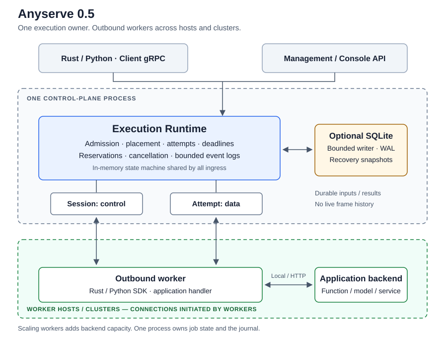

# Execution Architecture

This page describes Anyserve 0.5.0, reviewed against runtime source at `aa94ad9`
on 2026-10-19. It is the current architecture reference. The
[redesign acceptance record](redesign.md) and reference reviews preserve earlier
decisions and evidence. For startup, restart and migration procedures, read
[deployment and recovery](deployment.md).

## System boundary

One control-plane process owns an in-memory execution Runtime and an optional
SQLite recovery journal. Workers connect outbound from other hosts or clusters;
they need no inbound listener. The supported deployment has one owner of the
journal. Adding workers scales execution capacity; it does not create additional
control-plane writers.



| Component | Responsibility |
|---|---|
| Runtime | Admission, jobs, placement, capacity reservations, attempts, deadlines, cancellation and bounded event logs |
| Journal | Durable recovery snapshots, complete inputs, final results and completion receipts through a bounded SQLite writer queue |
| gRPC, HTTP/OpenAI and console adapters | Authentication, protocol translation and views of the same Runtime |
| Rust/Python worker SDK and built-in HTTP worker | Outbound sessions, input/result transport, flow control, backend invocation and cancellation propagation |
| Inference backend | Model loading, token batching, model memory and backend-specific execution |
| Deployment platform | GPU assignment, worker replicas, networking, storage and process restart |

The Runtime matches opaque objects and metadata. It does not interpret tokens,
move KV caches, download object URIs or reconcile Kubernetes resources. The
console reads Runtime views and events directly; it has no separate job model.

## Execution entry points

| Property | Invoke | Submit |
|---|---|---|
| Durability | Always ephemeral | Durable by default; explicit ephemeral is supported |
| Input | Complete objects or live input chunks | Complete input before acceptance |
| Lifetime | Owned by the invocation; disconnect/drop cancels unfinished work | Independent of a Watch connection |
| Output | Accepted, Assigned, Output and Finished events | GetJob and Watch; terminal outputs are available by ID while retained |
| Restart | State and live output history are lost | Durable input, committed attempt count and final result survive; ephemeral Submit is lost |
| Typical ingress | Native Invoke, HTTP invoke and OpenAI adapters | Native/Python asynchronous jobs |

Durability and output delivery are separate choices. The embedded Runtime offers
`Delivery::Buffered` and `Delivery::Streamed`. The native gRPC Invoke adapter
always chooses Streamed, even if an SDK consumer collects the answer in memory.
HTTP invoke uses Buffered; OpenAI chat selects delivery from its `stream` flag,
and embeddings use Buffered.

For Streamed delivery, an attempt becomes exposed when its first non-progress
output enters the event log, including while that output is still buffered in
transport. An exposed attempt cannot be silently replaced. Buffered delivery
keeps attempt output private until success and permits transparent retries.

## Job lifecycle and placement

The public states are Queued, Running, Succeeded, Failed and Cancelled. Internally
the Runtime also tracks acceptance, attempt-start and terminal commits:

```text
durable: Accepting -> Queued -> Starting -> Assigned -> Running -> Terminating -> Terminal
ephemeral:           Queued ------------> Assigned -> Running ---------------> Terminal
                         ^                              |
                         +---- eligible attempt retry --+
```

This is the normal successful path; rejection, cancellation and deadline expiry
can leave it earlier. Accepting and Starting appear as Queued to clients.
Terminating preserves the preceding public state until its commit completes.

Admission checks protocol limits, unfinished-job count, per-interface queue
length and the global input budget. Durable acceptance also requires a writable
journal. A job waiting for its acceptance commit counts toward admission.

Queues are ordered by priority and then arrival within each interface. Dispatch
examines a bounded set with a rotating scan so incompatible jobs at the head do
not indefinitely hide compatible work. Worker selection proceeds as follows:

1. Filter on interface, connected/non-draining status, free-slot credit,
   concurrency, required attributes and available required capacity.
2. Before `spillover_after` expires, require all preferred attributes. Afterward,
   keep required constraints and allow partial preference matches. Without a
   hold interval, preferences rank workers immediately.
3. Prefer sessions that have not rejected this job, then the greatest number of
   matching preferred attributes.
4. Among equally ranked candidates, sample two and choose the lower load score:
   active reservations / concurrency, plus reported utilization and queued load.

A reservation is made before assignment and released once on completion or
cancellation acknowledgement/fencing. For durable jobs, the attempt count is
committed before Assign is sent. Required capacity is worker-advertised accounting;
it does not allocate or enforce physical GPU resources.

## Attempts, retries and deadlines

There are two distinct retry mechanisms:

| Mechanism | Owner | Effect |
|---|---|---|
| Execution retry | Runtime | Starts a new attempt, consumes the job's attempt budget and may invoke the backend again |
| Transport/result retry | Worker SDK | Reopens the same lease or retransmits its result; does not invoke the backend again |

`ExecutionPolicy.max_attempts` includes the first attempt. Absent/zero selects
the server default; one disables execution retries, and the server caps larger
values. Worker failures marked `ErrorInfo.retryable` and retryable runtime
failures can retry within this budget and the job's deadlines. An exposed
streamed attempt ends with `output_interrupted` instead of switching attempts.
External side effects therefore require application idempotency: durable
execution is at least once.

| Deadline | Scope | Typical outcome |
|---|---|---|
| Queue timeout | Each queued period, before an attempt starts | `queue_timeout` |
| Execution timeout | One attempt | Retryable `execution_timeout` |
| Total timeout | Acceptance through terminal state, across attempts | `total_timeout` |
| Heartbeat timeout | Worker session liveness and reconnect grace | Lost leases become retryable `worker_lost` after grace |
| Consumer stall timeout | Bounded waiting for streamed delivery or global event capacity | `consumer_stalled` or Attempt `RESOURCE_EXHAUSTED`, depending on the cause |

SDK open/commit retries use a 100 ms initial backoff base, exponential growth to
5 s and jitter. Each operation has a monotonic retry window of four negotiated
heartbeat timeouts; reconnecting does not renew it. Assignment wall-clock
deadlines are backend hints, not clocks the SDK compares with the worker's local
time. The server owns job deadlines and sends Cancel/Fence.

## Durable commit and recovery

The journal stores recovery snapshots rather than an event history. Its three
commit boundaries are:

| Boundary | Persisted state | What must wait |
|---|---|---|
| Acceptance | Job spec, complete input/params, fingerprint and recovery state | Submit acknowledgement and scheduling |
| Attempt start | Incremented attempt count and update time on the job row | Worker assignment |
| Terminal | Final state, outputs/error, last attempt/worker and winning-lease completion receipt | Finish acknowledgement and completion reservation release |

There is no per-attempt journal table or persisted live event stream. Attempt
identities are live state; the winning identity and digest are saved at terminal
commit. Accepted and Finished events for cold reads are reconstructed from the
job snapshot.

One bounded writer groups SQLite transactions, using WAL and FULL synchronization
by default. State transitions run under the Runtime lock; journal waits occur
outside it. Commit callbacks belong to the Runtime and continue if the RPC that
triggered them disappears.

A definite acceptance/start rollback undoes its preparation. A terminal rollback
keeps the same TerminalPlan for retry and reports Unavailable to current waiters.
Rollback temporarily degrades durable admission until a writable probe succeeds,
normally checked after about one second. An unknown commit outcome freezes its
job identity, releases its reservation and stops durable work until restart
reconciles persisted state. Repeated Finish returns Unavailable while unknown.
Unrelated ephemeral work can continue, although runtime readiness reflects the
journal failure.

Startup advances the persisted generation and recovers unfinished durable jobs
with their committed attempt counts. Stale active leases are fenced. Work can
start a new attempt if its budget remains. A completed winning lease can reopen
only for receipt validation: the worker resends the same outcome/result, and the
server recomputes its digest before acknowledging. This does not rerun the engine.

## Identity and history retention

Durable jobs and explicit-ID Submit compute a canonical spec fingerprint.
`USE_EXISTING` returns the existing job for the same fingerprint and conflicts on
a different spec; `FAIL` rejects any existing ID. An ID originally created
without a fingerprint cannot later be claimed by an idempotent Submit. Invoke
and automatic-ID ephemeral Submit leave `JobView.spec_hash` empty. Business and
input metadata count toward identity; the documented trace/request-context keys
do not. Identity reuse is bounded by retention.

| Read situation | Available history |
|---|---|
| Live retained job | Bounded events after the requested cursor |
| Finished ephemeral job | Existing followers finish reading their events; afterward the log compacts to Finished and terminal outputs |
| Durable job read cold or after restart | Synthetic Accepted/Finished as applicable; former frames and assignments are unavailable |
| Expired nonzero cursor | Explicit `CursorExpired` with the oldest available sequence |

A zero cursor always starts at the earliest retained event. Sequences increase
per job across generations. `ListJobs` lists live Runtime entries, not the entire
SQLite archive; use GetJob/Watch by ID for cold durable results. Terminal jobs
release in-memory inputs and params. The console marks incomplete history and
unavailable request specs rather than inventing attempt records.

## Worker transport and stream completion

The `anyserve.v2` protocol has Client.Submit/Invoke/Watch/GetJob/Cancel/ListJobs
and Worker.Session/Attempt. Session carries Hello/Welcome, assignments,
heartbeats, absolute free-slot credits, Cancel and Fence. Each Attempt carries
input, frames, result chunks and Finish. Control and data use separate
connections so a large upload cannot block heartbeat or cancellation.

Welcome negotiates heartbeat timing, chunk size and the per-attempt byte window.
Assign inlines small inputs; larger or live input travels over Attempt. Object
URIs remain opaque references. Frames have monotonically increasing per-attempt
sequences; acknowledgements release the SDK window. A successful durable Finish
waits for terminal commit.

Protocol completion includes closing the HTTP/2 stream. The native event SDK
reads through response trailers before exposing Finished. After answering an
attempt, the server reads remaining request messages until EOF/error, bounded by
`heartbeat_timeout`. This avoids accumulated resets closing a shared connection.
If a reopened live lease is missing frames already sent by the worker, the SDK
reports `output_interrupted` instead of committing truncated success. Terminal
receipt replay still retransmits the original outcome.

A server Drain stops new assignments for that session. Workers can reconnect
after a short control-plane restart; a new generation fences old unfinished
attempts. Local stop signals shut down the worker. The built-in HTTP worker
uses connect and read-inactivity timeouts, allowing active SSE responses to run
longer than one inactivity interval.

## Memory bounds and pressure

| Global budget | Lifecycle | Pressure behavior |
|---|---|---|
| Input | Acceptance until terminal state | Reject admission or additional live input that cannot reserve capacity |
| Result | Upload until the last reference drops | Evict oldest terminal jobs, retry reservation once, then return `RESOURCE_EXHAUSTED` |
| Event | Event append until eviction or log compaction | Reclaim terminal history; wait for consumer progress or global budget release within `consumer_stall_timeout` |

An individual streamed consumer that stops reading can fail its job with
`consumer_stalled`. Global event pressure instead ends the Attempt with
`RESOURCE_EXHAUSTED` after bounded waiting; the built-in worker reports retryable
failure, subject to the exposure rule. Jobs without a primary streamed consumer
evict old history and report cursor expiry. Lifecycle events retain their bounded
fixed-overhead exception; output payloads cannot bypass reservation.

These budgets may overlap on shared `Bytes` and are not an additive RSS limit.
Per-job event counts/bytes, object sizes, queue lengths, sessions and the writer
queue have separate bounds. Evicting a job only releases the Runtime's own
references. Retention/count maintenance does not forcibly clear fresh results
at a percentage threshold. Compacted events and evicted jobs are freed after
releasing the global state lock. See [configuration](configuration.md) for exact
defaults and overflow behavior.

## Implementation map

Paths below are relative to the repository root.

| Area | Source |
|---|---|
| Wire protocol | `crates/anyserve-proto/protos/execution.proto` |
| Runtime API and defaults | `crates/anyserve-core/src/runtime/api.rs` |
| Admission, public operations, timers and recovery | `crates/anyserve-core/src/runtime/mod.rs` |
| State transitions, dispatch and placement | `crates/anyserve-core/src/runtime/machine.rs`, `state.rs` |
| Worker leases, cancellation and frame processing | `crates/anyserve-core/src/runtime/worker.rs` |
| Event/input budgets and replay | `crates/anyserve-core/src/runtime/events.rs`, `input.rs` |
| Recovery journal and commit verification | `crates/anyserve-core/src/journal.rs` |
| gRPC adapters and stream completion | `crates/anyserve-core/src/client_service.rs`, `worker_service.rs` |
| SDK result retransmission and event trailers | `crates/anyserve-client/src/execution/attempt.rs`, `events.rs` |
| CLI configuration, HTTP/OpenAI, worker and console | `crates/anyserve-cli/src/` |
| Python API and native binding | `clients/python/python/anyserve/`, `clients/python/src/` |

Use [testing](testing.md) to validate implementation changes. The
[2026-10-19 load results](benchmark-results.md) record mock-backend measurements
for specific revisions and a single host; they do not establish GPU throughput,
WAN latency or a universal capacity limit.
