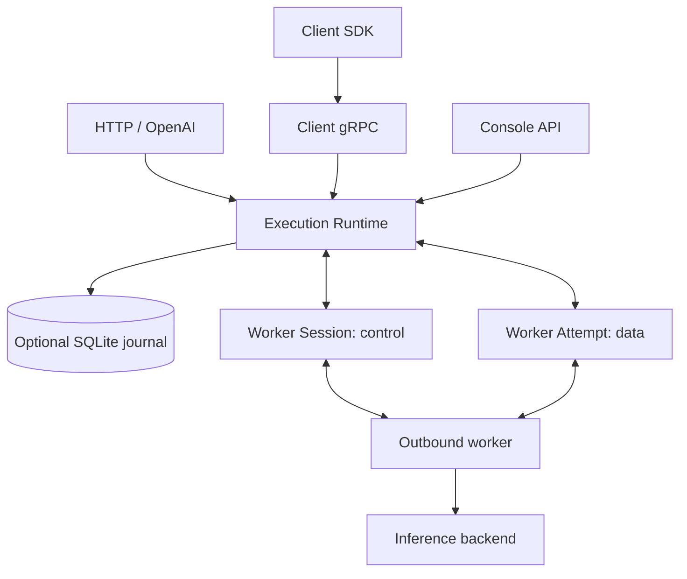

# Architecture

Anyserve has one in-memory execution runtime and an optional SQLite recovery
journal. The supported deployment is one control-plane process, with outbound
workers on any number of hosts or clusters. A persistent volume preserves the
journal across a brief restart. This design does not support active control-plane
replicas or distributed database coordination.

## Responsibilities

The Runtime owns admission, jobs, capability matching, capacity reservations,
worker sessions, attempts, deadlines, cancellation and bounded event logs. Both
HTTP gateways and gRPC adapters use this state machine. The console reads Runtime
views and events directly; there is no second domain model or compatibility
service.

A job specifies an interface, required/preferred attributes, resource quantities,
opaque inputs and execution policy. A worker advertises interfaces, attributes,
resource capacity, concurrency and free-slot credits. Required constraints always
apply; preferred attributes hold placement until `spillover_after` elapses.
Priority queues rotate their scan to avoid starvation behind incompatible jobs.

Workers own backend calls, model loading and execution. The Runtime does not
understand tokens, inference batching or model memory layout. Kubernetes and
engine scheduling remain outside it.

## Two execution semantics

`Invoke` is ephemeral. It supports complete input or a sequence of input chunks;
the caller consumes Accepted, Assigned, Output and Finished events. Dropping the
invocation cancels it. Its state does not survive a control-plane restart. HTTP
invoke and OpenAI adapters choose ephemeral execution. Buffered responses keep
attempt output private until success; streamed execution marks an attempt exposed
when its first non-progress output enters the log. An exposed attempt cannot be
transparently replaced, including when its output is still buffered in transport.

`Submit` defaults to durable and requires complete input. The optional journal
must be enabled. The acceptance acknowledgement means the job and input have
committed; the final worker acknowledgement means the terminal result and receipt
have committed. An explicit ephemeral Submit is allowed, but its retained result
may expire or be evicted and is lost on restart.

Execution is at least once. `ExecutionPolicy.max_attempts` includes the first
attempt, defaults to the server setting when absent/zero, and is capped by the
server. A value of one disables retries. Worker `ErrorInfo.retryable` determines
whether a reported failure is eligible; retry backoff is a runtime policy.
Queue, execution and total deadlines apply independently.

## Durable commit boundaries

1. Acceptance saves the complete input, canonical spec fingerprint and recovery
   state atomically before scheduling or replying.
2. Attempt start commits its identity and incremented attempt count before
   assignment. Heartbeats and capacity checks remain in memory.
3. Terminal commit saves final state, outputs and a server-computed completion
   receipt before acknowledging Finish and releasing the reservation.

One bounded writer owns SQLite transactions and completion callbacks. Its work
continues if the originating RPC disappears; no state lock is held across a
journal await. WAL and FULL synchronization are the defaults. Acceptance and
attempt-start rollback undo their preparation. A terminal rollback keeps its
TerminalPlan and retries the same commit; waiters receive Unavailable and can
retry. An indeterminate commit releases its lease reservation and quarantines
that job until restart reconciles persisted state. Repeated Finish returns
Unavailable while the result is unknown; the runtime does not reuse the identity. Journal failure rejects durable admission while
unrelated ephemeral work continues. A definite journal rollback, including a
logical conflict, temporarily degrades durable admission until the next writable
probe (about one second); this can cause a short admission interruption.
Expired journal records are purged in batches of 500, each queued independently
so normal commits can run between batches.

## Recovery and identity

Startup advances the generation, loads unfinished durable jobs and uses their
committed attempt counts. Old active leases are fenced. A completed lease can
reopen only to resend its retained result: the server recomputes and compares the
receipt before acknowledging, including when the original acknowledgement was
lost across restart. Workers do not re-run the backend merely to retransmit a
result.

Only durable jobs and explicit-ID Submit calculate a spec fingerprint. A repeated
explicit ID with the same fingerprint returns the existing job; a different spec
conflicts. An ID originally created without a fingerprint cannot subsequently be
claimed by an idempotent Submit. Invoke and automatic-ID ephemeral Submit leave
`JobView.spec_hash` empty. Business/input metadata participates in identity;
transport trace keys are excluded.

Completed durable jobs can leave memory and remain readable by ID from SQLite.
Cold `Watch`/`events` reconstruct Accepted and Finished, not the previous frames
or assignment history. The synthetic Finished uses the final sequence of the
current generation, after every live event. A zero cursor starts at the earliest
retained event and never expires, including after recovery. An expired nonzero
cursor across recovery is reported explicitly. List operations show jobs retained
in the live Runtime.
A finished ephemeral job keeps only its outcome, as an evicted durable job
does. Readers that were following its log when it finished (an Invoke caller,
a `Watch`) still receive every event; once the last of them is done, the log
drops every event before Finished. After that, `Watch` and `events` from zero
return Finished with its outputs, and an older nonzero cursor gets
`CursorExpired`. Assignment history and frames of a finished ephemeral job are
not kept for later readers.
The console marks incomplete history and unavailable in-memory request specs;
it does not invent attempt records. Terminal jobs release their retained inputs
and params.

## Transport, flow control and cancellation

There is one execution protocol: Client.Submit/Invoke/Watch/GetJob/Cancel/ListJobs,
and Worker.Session/Attempt. Control and data use separate connections so a large
upload cannot block heartbeat, credits or cancellation. Welcome negotiates
heartbeat timing, chunk size and the per-attempt byte window. Assign inlines
small inputs; larger inputs are chunked over Attempt. URI objects are opaque
references, not automatic downloads by the Runtime.

Frames carry monotonic per-attempt sequences. Acknowledgements release the SDK
window; results are acknowledged after commit for durable jobs. Abnormal stream
termination is an error. A slow primary streamed consumer causes bounded
backpressure and eventually `consumer_stalled`; an expired nonzero replay cursor returns
its oldest available sequence. Optional observer/history reads do not pin all
past output forever.

SDK transport retries use a 100 ms initial backoff base, double to a 5 s cap and
apply jitter. Each open/commit operation has a monotonic retry window of four
negotiated heartbeat timeouts; retries never renew that window. The server owns
job deadlines and sends Cancel/Fence when they expire. Assignment wall-clock
deadlines remain backend hints; the SDK does not compare them with the worker's
local clock. Result retransmission never re-runs the backend.

A server Drain stops new assignments for that session. Workers stay alive through
control-plane restart and reconnect after the session ends; a new generation
fences unfinished old attempts. Local stop signals shut down the worker. The
built-in HTTP worker applies connect and read-inactivity timeouts, allowing an
active SSE stream to run longer than a single timeout interval.

Three global byte budgets cover input, result and event lifecycles. Upload
pressure triggers eviction of the oldest terminal jobs and one reservation retry.
If outstanding references still hold the result budget, the upload returns
RESOURCE_EXHAUSTED. A streamed frame under global event pressure instead waits
for consumer progress or budget release, bounded by `consumer_stall_timeout`;
on expiry global pressure returns RESOURCE_EXHAUSTED, while its own slow consumer
fails with `consumer_stalled`. Small lifecycle events are always recorded and
may exceed the event budget by their bounded fixed overhead. Maintenance eviction
follows retention and terminal-count limits; it does not clear fresh results at a percentage threshold. See the
[configuration reference](configuration.md) for defaults and observable limits.

Client and worker bearer roles are separate. The console and HTTP adapters require
a client token when auth is enabled; CORS is independent of authentication. TLS
is configurable on gRPC. Graceful shutdown stops admission, drains sessions and
waits for the journal; ephemeral connections may end during restart.

## Migration from 0.4

Use a matching 0.5 binary, Rust/Python SDK and protocol together. The previous
control-plane protocol, generic named streams and worker polling RPCs have been
removed. Input belongs in Submit or Invoke; output is read through execution
events and terminal outputs.

Replace old storage/frame backend sections with `[runtime]` and optional
`[journal]`. `anyserve serve` enables `.anyserve/journal.sqlite` by default;
`--ephemeral` disables durable admission. In embedded Runtime use, the journal
is opt-in. The new journal is a recovery format, not an in-place upgrade of the
old SQL schema. Drain the old deployment, preserve its data for rollback and
start the new release with a fresh journal. To roll back, restore the previous
binary/SDK with its corresponding data; do not point it at the new journal.
